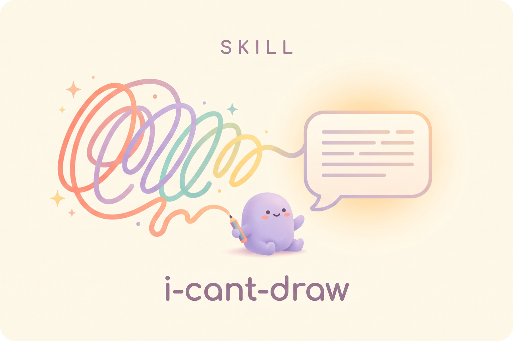
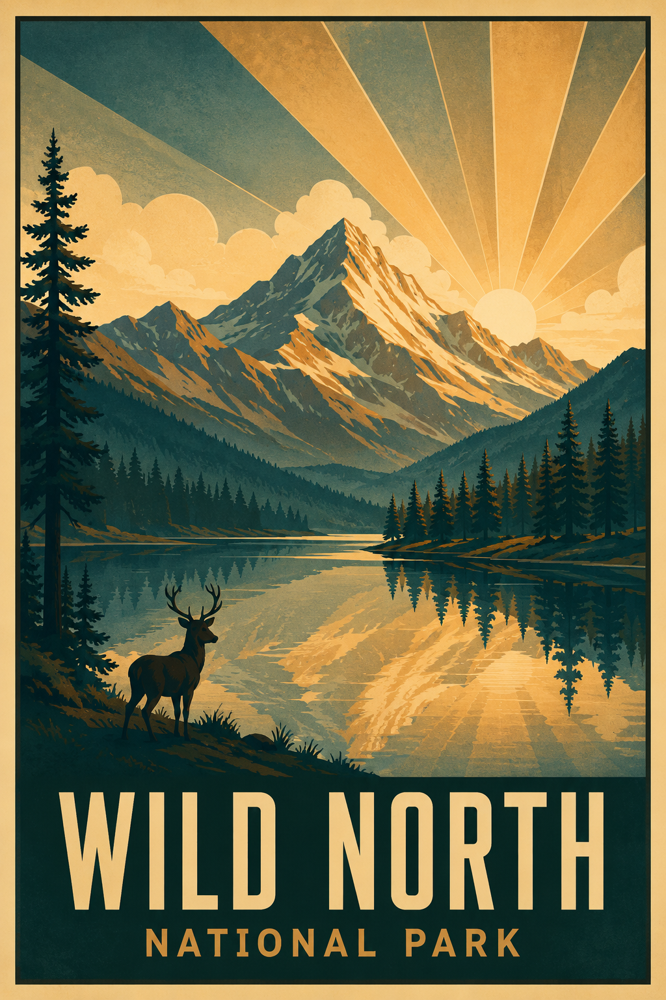
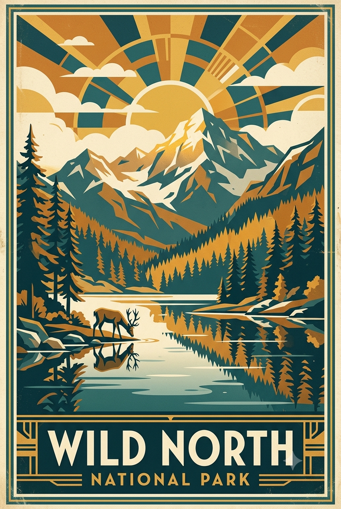

<!--
GitHub metadata — authored here, applied in repo Settings (NOT rendered on the page):

About:  Turn a rough idea into a ready-to-paste image-generation prompt for
        ChatGPT (GPT Image) or Gemini (Nano Banana) — a Claude Code skill
        that writes the prompt, not the image.

Topics (ranked): prompt-engineering, image-prompts, image-generation,
                 claude-code, claude-skill, agent-skill, anthropic,
                 gpt-image, nano-banana, openai, gemini, text-to-image,
                 ai-art, prompt-builder, creative-tools, markdown

Social preview: docs/media/hero.png is the 1536x1024 source; the card is
  derived, never committed —
    python Tools/image_compress.py docs/media/hero.png 1MB --glass
  then upload docs/media/hero-glass.jpg in Settings > Social preview.
  See GitHub/docs/image-processing.md.
-->

<h1 align="center">🖍️ i-cant-draw</h1>
<p align="center"><strong>Pick a model, describe the scene, get a ready-to-paste image prompt. No art skills needed.</strong></p>
<p align="center"><em>You pick the engine; the skill writes the prompt and its config — it never renders the image.</em></p>
<p align="center">
  <a href="LICENSE"></a>
</p>

<p align="center">
  
</p>

`i-cant-draw` is a skill that turns a rough image idea into a prompt that **ChatGPT (OpenAI GPT Image)** or **Google Gemini (Nano Banana)** actually renders well. You choose the engine; the skill builds the prompt — and that engine's config — from a self-contained, engine-specific guide. It does **not** generate the image; it generates the *prompt* you paste into the tool.

## How it works

```
1. Call the skill        →  /i-cant-draw
2. Pick the model        →  ChatGPT  or  Gemini
3. Describe the scene    →  "a logo for my coffee shop, Morning Brew, cosy and minimal"
4. Get the prompt        →  a finished prompt + that model's config, ready to paste
```

The two engines never collide: the skill loads **one** guide — [`references/chatgpt.md`](./skills/i-cant-draw/references/chatgpt.md) or [`references/gemini.md`](./skills/i-cant-draw/references/gemini.md) — and follows only that one. So there are no conflicting rules to reconcile; each guide is clean, current, and complete for its engine.

## Example

**You:** `/i-cant-draw` → *Gemini* → "a logo for my coffee shop, Morning Brew, cosy and minimal"

**You get back:**

> Original minimalist logo for a coffee shop. Wordmark text (EXACT, verbatim): "MORNING BREW", in a clean rounded serif, centred below the icon. A single steaming-cup line-art icon above the text, flat vector, minimal strokes, no gradients. Warm brown and cream palette, plain white background, reads clearly at small sizes. No watermark, no extra text.
>
> **Config** — `model="gemini-3-pro-image"`, `aspect_ratio="1:1"`, `image_size="2K"`.

Paste that into Gemini and you get a clean logo instead of a garbled blob. Ask for ChatGPT instead and the same scene comes back with `size="1024x1024"`, `quality="high"` and OpenAI-specific phrasing.

## See it work

The same scene — a vintage travel poster titled **"WILD NORTH / NATIONAL PARK"** — run through the skill for each engine, then generated from the prompt it produced. Both render the title text cleanly, which is the whole point.

<table>
<tr>
<td width="50%" align="center"><strong>ChatGPT · gpt-image-2</strong><br></td>
<td width="50%" align="center"><strong>Gemini · Nano Banana Pro</strong><br></td>
</tr>
</table>

## Supported engines

| Engine | Models | Guide |
|---|---|---|
| **ChatGPT / OpenAI GPT Image** | `gpt-image-2`, `gpt-image-1.5`, `gpt-image-1-mini` | [`references/chatgpt.md`](./skills/i-cant-draw/references/chatgpt.md) |
| **Google Gemini / Nano Banana** | `gemini-3.1-flash-image`, `gemini-3-pro-image`, `gemini-3.1-flash-lite-image` | [`references/gemini.md`](./skills/i-cant-draw/references/gemini.md) |

## Install (Claude Code plugin)

```bash
git clone https://github.com/AdinathChaudhari/i-cant-draw ./i-cant-draw
claude plugin marketplace add ./i-cant-draw
claude plugin install i-cant-draw@i-cant-draw
```

Then type `/i-cant-draw`, pick a model, and describe the image. Disable with `claude plugin disable i-cant-draw`. More in [INSTALL.md](./INSTALL.md).

## Use it anywhere else

The skill files are plain markdown and model-agnostic. Paste [`SKILL.md`](./skills/i-cant-draw/SKILL.md) plus the engine guide you want into a Custom GPT's instructions, a Gemini Gem, any assistant's system prompt, or a `.cursorrules` file. It teaches *how to prompt an image model*, so any model that writes the prompt can use it.

## The universal rules (both engines agree)

The engine guides add the per-model config; these hold either way — and both OpenAI and Google state them:

1. **Prose, not tags.** Full sentences describing a scene — never comma-separated keywords or `--flags`.
2. **Order it like the model builds it.** Background → subject → key details → style → constraints last.
3. **Say the exact words.** Concrete camera/lighting/palette terms, not "beautiful" or "8k".
4. **Quote in-image text.** Exact string in quotes, spell tricky words out, name the font style — keep it short.
5. **Describe what you want, not what you don't.** Neither engine has a working negative-prompt field; one brief exclusion clause at the end only.

## Which engine when

- **Gemini** — character/subject consistency across a series, reference-heavy composition, conversational editing.
- **ChatGPT** — transparent-background assets, several variants from one call (`n`), a moderation-strictness lever.

Both watermark every output with SynthID by default, so neither produces an "undetectable" AI image.

## Tune it

Edit the router in [`SKILL.md`](./skills/i-cant-draw/SKILL.md) or an engine guide under `references/`, then re-invoke `/i-cant-draw`.

## Credits

Inspired by the direct, principle-first spirit of [i-have-adhd](https://github.com/ayghri/i-have-adhd) — pointed at image prompts instead of chat replies. Prompting guidance distilled from OpenAI's and Google's official image-generation docs (2026).

## License

MIT. Star ⭐ if it saved you a round of "why is there a garbled word on my poster?"
